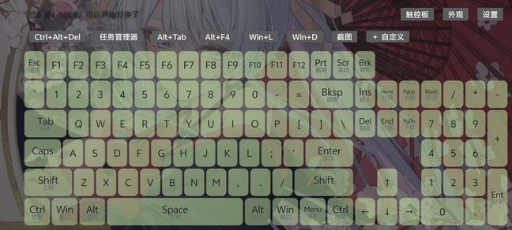
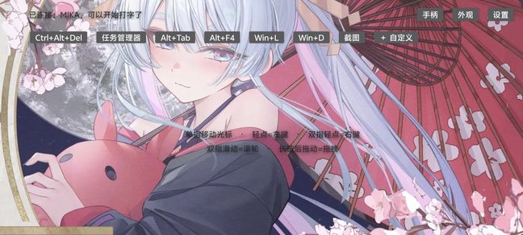
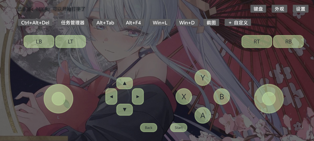

# 掌上全键盘 · PocketKeyboard

把 Android 手机变成一台**电脑级蓝牙键鼠**：104 键全键盘 + 触控板 + 自定义快捷键 + 可换皮肤，电脑端零安装、蓝牙配对一次即用。


[-3DDC84?logo=android&logoColor=white)](#)
[](LICENSE)
[](#)
[](#)

> Android 手机通过 `BluetoothHidDevice` 注册为 BR/EDR HID 复合设备（键盘 + 鼠标 + 可选手柄），
> 电脑、平板、电视盒子等蓝牙主机无需安装任何软件即可识别。

---

## 截图

| 键盘 | 触控板 | 虚拟手柄（实验性） |
|---|---|---|
|  |  |  |

> 截图使用自定义图片背景；默认是深色纯色皮肤。

## 功能

- **104 键全键盘**：Ctrl / Alt / Shift / Win / F1–F12 / 方向键 / 小键盘 / 编辑键一应俱全
- **多指组合键**：两根手指同时按 `Ctrl` + `C` 即可发送组合键
- **粘滞键**：单点 `Ctrl`（变金色锁定）再点 `C`，单指也能打组合键
- **长按连发**：方向键、退格按住自动连发
- **自定义快捷键条**：填名称、勾修饰键、选按键，长按可编辑/删除，本地持久化
- **触控板模式**：单指移动、轻点左键、双指轻点右键、双指滚动、长按拖动
- **可换皮肤**：键盘与触控板**独立**设置背景（纯色 HSV 或相册图片）、压暗/提亮、按键颜色与透明度
- **虚拟手柄（实验性）**：开关后 HID 增加手柄设备，含双摇杆、方向键、ABXY、肩键、Start/Back
- **中文界面**、沉浸式横屏、刘海/手势条安全区适配
- **不需要 Root**，不依赖 Xposed / ADB，不上传任何数据

## 安装

从 [Releases](../../releases) 下载 `app-debug.apk` 安装（debug 签名，自用足够）。

也可以自己构建（见下文），产物在 `app/build/outputs/apk/debug/app-debug.apk`。

## 首次使用

1. 手机打开 App，允许「附近的设备」权限（Android 12+ 为 `BLUETOOTH_CONNECT`）。
2. 顶部出现“已注册为蓝牙键盘…”后，进入 **设置 → 让电脑搜到我**。
3. 电脑：设置 → 蓝牙和设备 → 添加设备 → 选择手机名称 → 配对。
4. 手机顶部显示「已连接：xxx」即可开始输入；电脑设备列表里会出现一个键盘设备。

配对失败的排查顺序：电脑删除旧配对 → 手机重新「让电脑搜到我」→ 再配对。

## 使用说明

### 键盘

| 操作 | 效果 |
|---|---|
| 多指同时按 `Ctrl` + `C` | 组合键 |
| 单点 `Ctrl`（变金色锁定）再点 `C` | 粘滞键 |
| 按住方向键 / 退格 | 电脑端连发 |
| 顶部「＋ 自定义」 | 新增快捷键 |
| 长按快捷键按钮 | 编辑 / 删除 |
| 小键盘 `Num` | 切换 NumLock |

### 触控板

| 操作 | 效果 |
|---|---|
| 单指拖动 | 移动光标 |
| 单指轻点 | 左键单击 |
| 双指轻点 | 右键单击 |
| 双指上下滑 | 滚轮 |
| 长按后拖动 | 按住左键拖拽 |

### 外观（皮肤）

「外观」→ 分别设置 **键盘外观** / **触控板外观**：

- 背景：纯色（色相 / 饱和度 / 明度）或从相册选图（自动缩放、居中裁剪）
- 压暗 / 提亮：0–100% 遮罩，纯色和图片都生效
- 按键：色相 / 饱和度 / 明度 + 透明度（图片背景时可透出）
- 整页背景随当前模式切换：键盘模式用键盘主题，触控板模式用触控板主题

### 虚拟手柄（实验性）

设置 → 勾选「实验性功能：虚拟手柄」→ 会在电脑上多出一个游戏控制器。
顶部模式按钮循环：键盘 → 触控板 → 手柄 → 键盘。
开关手柄会重新注册 HID 描述符，**电脑上需要重新连接一次**。

## 构建

环境要求：JDK 17、Android SDK Platform 35、Gradle 8.10.2（仓库自带 wrapper）。

```bash
# 1. 指定 SDK（或复制 local.properties.example 为 local.properties 并修改）
export ANDROID_HOME="$HOME/Android/Sdk"      # Windows: set ANDROID_HOME=C:\Users\you\AppData\Local\Android\Sdk

# 2. 构建 debug APK
./gradlew assembleDebug

# Windows
gradlew.bat assembleDebug
```

产物：`app/build/outputs/apk/debug/app-debug.apk`

> 若把项目放在**含中文/空格的路径**下，AGP 默认会拒绝；仓库已在 `gradle.properties` 打开
> `android.overridePathCheck=true`。

## 技术说明

### HID 报文

| 设备 | Report ID | 长度 | 内容 |
|---|---|---|---|
| 键盘 | 1 | 8 字节 | `[修饰键][保留][6 个按键 usage]` |
| 鼠标 | 2 | 4 字节 | `[按键位][dx][dy][wheel]` |
| 手柄 | 3 | 7 字节 | `[按键低][按键高][X][Y][Z][Rz][hat]` |

- 描述符定义在 `ReportDescriptor.java`（键盘 + 鼠标）与 `GamepadDescriptor.java`（手柄）
- 兼容模式（设置里可开）会退回**不带 Report ID 的经典 43 字节键盘描述符**，用于少数识别不了复合设备的系统；此时鼠标/手柄不可用
- 发送失败会自动重新注册 HID；断线后自动重连（回到前台也会主动连接）
- 关键 API：`BluetoothHidDeviceAppSdpSettings` + `registerApp(sdp, null, null, executor, callback)`，回包用 `replyReport(...)`

### 项目结构

```
app/src/main/java/com/zhangshang/keyboard/
├── MainActivity.java            界面与交互：状态栏、快捷键条、模式切换、外观设置
├── HidKeyboardManager.java      HID 注册/回调/重连，键盘、鼠标、手柄报文
├── ReportDescriptor.java        键盘(Report ID 1) + 鼠标(Report ID 2) 描述符
├── ReportDescriptorCompat.java  兼容模式：经典键盘描述符
├── GamepadDescriptor.java       手柄描述符（Report ID 3）
├── GamepadView.java             虚拟手柄绘制与触控
├── KeyboardView.java            自绘键盘、多指、粘滞键、长按连发
├── TrackpadView.java            触控板手势
├── KeyLayout.java / KeyInfo.java / HidKeys.java   104 键布局与 usage
├── Macro.java / MacroStore.java / MacroKeys.java  自定义快捷键
├── AreaTheme.java / AreaStyle.java / ThemeStore.java  皮肤数据与配色计算
└── PageBackgroundDrawable.java  整页背景（颜色/图片 + 遮罩）
```

## 已知限制

- 进不了 BIOS / UEFI，开机前不可用
- 一次只能连一台主机
- 手机熄屏后无法操作（App 内已保持屏幕常亮）
- 纯 HID 只能发按键，中文输入由电脑输入法完成
- 部分厂商 ROM 裁剪了 HID Device 能力，会提示“本机蓝牙不支持 HID 设备模式”
- 虚拟手柄为实验性功能，个别系统对轴/hat 的映射可能不同

## Roadmap

- [ ] 前台服务保活（`FOREGROUND_SERVICE_CONNECTED_DEVICE`）
- [ ] 媒体键 / Consumer Control
- [ ] NKRO（全键无冲）
- [ ] 自定义布局编辑器
- [ ] 手柄轴反向、扳机模拟量
- [ ] 更多皮肤预设与导出/导入

## 贡献

欢迎 Issue 与 PR。提交前请阅读 [CONTRIBUTING.md](CONTRIBUTING.md)：

- 用 JDK 17 + `./gradlew assembleDebug` 确保能编译
- 不引入新依赖前先开 Issue 讨论
- UI 文案保持中文，代码注释可中英混排
- 涉及 HID 描述符的改动请在 PR 里说明测试机型与主机系统

## 文档

- [需求确认书](docs/requirements.zh.md)
- [蓝牙 HID 开源方案调研](docs/hid-research.zh.md)

## 许可证与素材声明

- 代码以 [MIT License](LICENSE) 开源。
- `icon/app_icon.jpg` 及派生图标（`res/mipmap-*`）为 AI 生成插画（用户提供，已裁掉生成水印），
  **版权与商用/分发授权由使用者自行确认，不包含在 MIT 许可内**。
  若要公开发布 Release，请确认你有权分发该素材；否则替换为自有/CC0 素材后重新生成图标
  （见 [icon/README.md](icon/README.md)）。

## 免责声明

本项目仅供学习与个人使用。使用本软件产生的任何设备兼容性、数据或法律问题由使用者自行承担；
请勿用于绕过设备安全策略或未经授权的场景。
